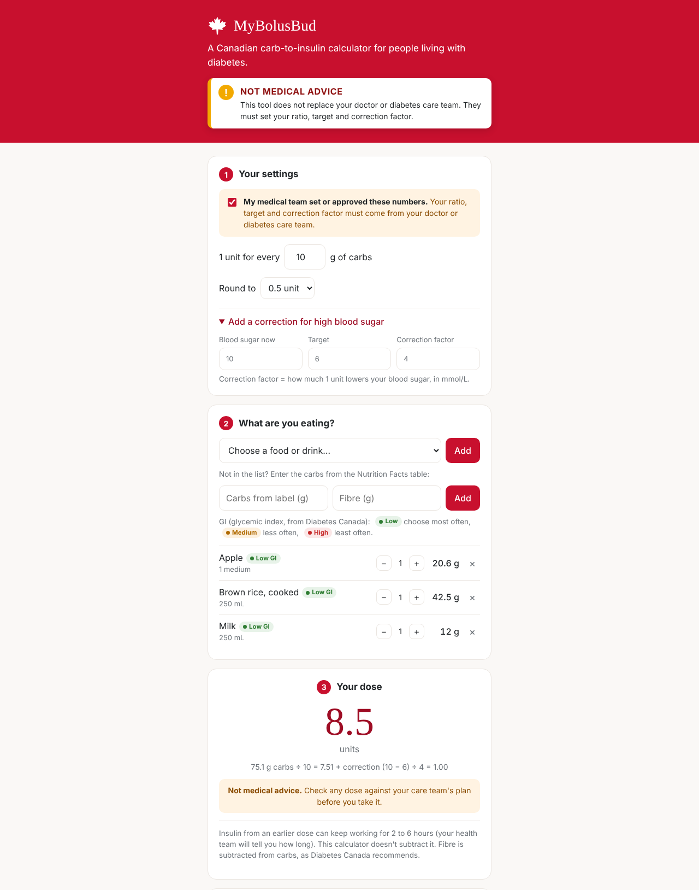

# MyBolusBud 🍁

A Carb-to-Insulin calculator for people living with diabetes.

**Live app:** https://shamarkea.github.io/mybolusbud

## What it does

- **Carb counting:** search 70+ common foods through a dropdown (Canadian servings in mL) or add your own from a Nutrition Facts table.
- **Fibre subtraction:** counts available carbohydrate (total carbs minus fibre), following Diabetes Canada's carb counting method. You can turn this off.
- **Glycemic index badges:** low, medium and high GI tags from Diabetes Canada's Glycemic Index Food Guide.
- **Mealtime dose:** carbs ÷ your insulin-to-carb ratio, rounded to what your pen or pump can deliver (1, 0.5, 0.1 or 0.05 units).
- **Correction dose (optional):** (current blood sugar − target) ÷ correction factor, in mmol/L.
- **Safety checks:**
  - Won't calculate a dose until you confirm your settings came from your medical team.
  - Below 4 mmol/L: no dose shown; tells you to treat the low first (15 g fast carbs, recheck in 15 minutes).
  - 14 mmol/L or higher: reminds you to check for ketones.
  - Flags unusual ratios, targets, correction factors and large doses.
  - Reminds you about insulin on board (usually 2 to 6 hours) to avoid stacking doses.
- **Private by design:** everything runs in your browser. No account, no server, no data sent anywhere.

## Built with

HTML, CSS and plain JavaScript in a single file. No frameworks or build step. Hosted on GitHub Pages.

## Sources

- Diabetes Canada: [Basic Carbohydrate Counting](https://diabetes.ca/managing-my-diabetes/tools---resources/basic-carbohydrate-counting) (07/25, 2023 Clinical Practice Guidelines)
- Diabetes Canada: [Glycemic Index Food Guide](https://www.diabetes.ca/resources/tools-resources/the-glycemic-index-(gi)) (07/25)
- Diabetes Canada: [Lows and Highs: Blood Sugar Levels](https://www.diabetes.ca/DiabetesCanadaWebsite/media/Managing-My-Diabetes/Tools%20and%20Resources/lows-and-highs-blood-sugar-levels.pdf?ext=.pdf)
- Health Canada: [Canadian Nutrient File](https://food-nutrition.canada.ca/cnf-fce)
- Health Canada: [Canada's Food Guide](https://food-guide.canada.ca/en/)
- Indigenous Services Canada: [Diabetes in First Nations and Inuit Communities](https://www.sac-isc.gc.ca/eng/1569960595332/1569960634063)

## Disclaimer

MyBolusBud is a personal project and **not medical advice**. It does not replace your doctor or diabetes care team. Your insulin-to-carb ratio, target blood sugar and correction factor must be set by your healthcare provider. The app does not account for insulin on board, exercise, illness or alcohol. Carb and fibre values are typical estimates; always check food labels.

Not affiliated with or endorsed by Diabetes Canada, Health Canada or Indigenous Services Canada.

## Ideas for future versions

- Live food search using Health Canada's Canadian Nutrient File
- mg/dL option for users outside Canada
- Saved favourite meals
- Insulin-on-board tracking with a care-team-set duration
